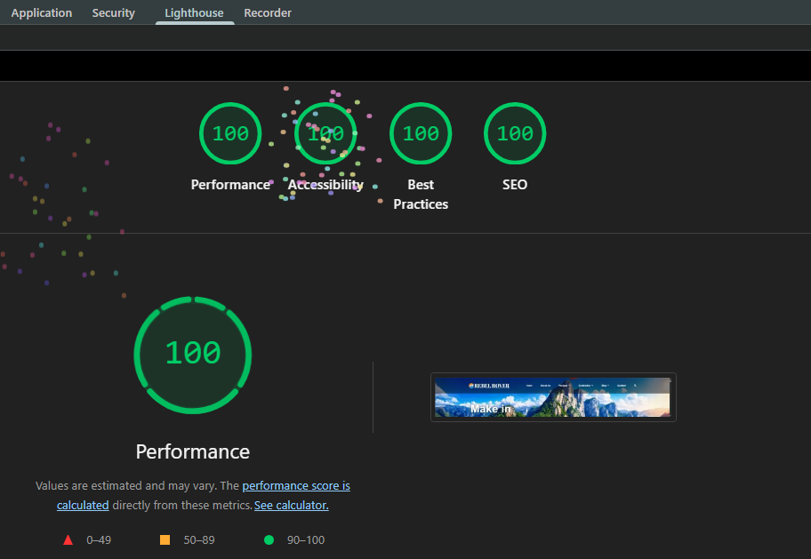
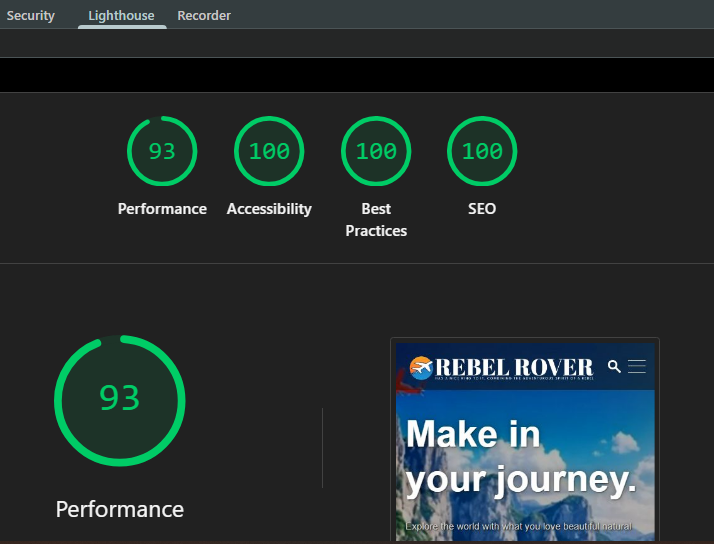

# 🌍 Rebel Rover — Multi-Page Travel Agency Website

A responsive, high-performance 5-page travel agency website built with semantic HTML5, modular SCSS (`@use`), and vanilla JavaScript. Engineered for top Core Web Vitals scores, full keyboard accessibility, and smooth fluid scaling across all viewports.

🔗 **[Live Demo on GitHub Pages](https://yurii-frontend25.github.io/portfolio/rebelrover/)**

---

## 🚀 Google Lighthouse Audit

| Desktop (`100 / 100 / 100 / 100`) | Mobile (`96 / 100 / 100 / 100`) |
| :---: | :---: |
|  |  |

## 📊 Page-by-Page Audit Summary (GitHub Pages)

| Page | Desktop (`Perf / A11y / BP / SEO`) | Mobile (`Perf / A11y / BP / SEO`) |
| :--- | :---: | :---: |
| **Home** (`index.html`) | `100 / 100 / 100 / 100` | `94–98 / 100 / 100 / 100` |
| **About Us** (`about.html`) | `100 / 100 / 100 / 100` | `98–100 / 100 / 100 / 100` |
| **Package** (`package.html`) | `100 / 100 / 100 / 100` | `98 / 100 / 100 / 100` |
| **Blog** (`blog.html`) | `99–100 / 100 / 100 / 100` | `98 / 100 / 100 / 100` |
| **Contacts** (`contact.html`) | `100 / 100 / 100 / 100` | `99 / 100 / 100 / 100` |

---

## ✨ Key Features & Optimizations

- **Fluid Responsive Layout (`1920px → 320px`):** Adaptive typography and spacing powered by custom SCSS `clamp()` / `adaptiveValue` mixins with zero horizontal overflow.
- **On-Demand Sliders (`IntersectionObserver` + Swiper.js):** Three custom carousels (*Explore*, *Why Us*, and *Testimonials*) with touch gestures and keyboard navigation that dynamically load `swiper-bundle.min.js` only when scrolled into view — keeping initial Total Blocking Time near `0 ms`.
- **Rendering & Asset Optimization:**
  - Off-screen rendering deferred via CSS `content-visibility: auto` and `contain-intrinsic-size`.
  - Next-gen **WebP** imagery wrapped in `<picture>` with explicit `width`/`height` attributes (`CLS = 0`), `fetchpriority="high"` for LCP heroes, and native `loading="lazy"`.
  - Self-hosted `.woff2` fonts (`font-display: swap`) and non-blocking stylesheet loading.
- **Accessibility (`100 / 100` WCAG Compliance):** Semantic HTML5 landmarks, ARIA attributes, high color contrast, accessible mobile burger menu, and custom `:focus-visible` states across all interactive elements.

---

## 🛠 Tech Stack

- **HTML5:** Semantic markup, BEM methodology, ARIA accessibility
- **SCSS / Sass:** Modular `@use` architecture, CSS Grid, Flexbox, fluid `rem` functions
- **JavaScript (ES6+):** Vanilla JS, `IntersectionObserver` API, dynamic script loading, Swiper.js

---

## 📁 Project Structure

```text
rebelrover/
├── css/                  # Compiled stylesheets & vendor CSS
├── fonts/                # Self-hosted .woff2 fonts & icon font
├── img/                  # Optimized WebP & fallback assets
├── js/
│   ├── main.js           # Navigation, scroll handlers, lazy Swiper loader
│   └── swiper-bundle.min.js
├── scss/
│   ├── fonts/            # @font-face & icon font definitions
│   ├── pages/            # Page-specific styles (index, about, package, blog, contacts)
│   ├── _colors.scss      # Color palette variables
│   ├── _common.scss      # Containers, layout wrapper, content-visibility rules
│   ├── _components.scss  # Reusable UI components & buttons
│   ├── _footer.scss      # Footer styles
│   ├── _header.scss      # Header & responsive navigation
│   ├── _reset.scss       # Modern CSS reset
│   ├── _settings.scss    # Breakpoints, toRem(), adaptiveValue() mixins
│   └── style.scss        # Main entry point
├── index.html
├── about.html
├── package.html
├── blog.html
└── contacts.html
```